# Google Agent Development Kit (ADK) Enterprise Multi-Agent Suite

[](https://www.python.org/downloads/)
[](https://cloud.google.com/blog/topics/developers-practitioners)
[](https://aistudio.google.com/)
[](https://modelcontextprotocol.io/)
[](https://cloud.google.com/alloydb)
[-brightgreen.svg)](https://docs.pytest.org/)

A production-grade, enterprise multi-agent suite built with the **Google Agent Development Kit (ADK)** and the Gemini model family. This repository provides five autonomous, end-to-end agents covering multi-hop deep research, external CLI subprocess tool pipelines, Model Context Protocol (MCP) software debugging, AST-driven automated code review with self-healing fix loops, and conversational e-commerce with dual-mode AlloyDB `pgvector` / local SQLite vector search.

---

## Table of Contents
- [1. System Architecture](#1-system-architecture)
- [2. Agent Comparison Matrix](#2-agent-comparison-matrix)
- [3. Quickstart & Installation](#3-quickstart--installation)
- [4. Step-by-Step Per-Agent Terminal Execution](#4-step-by-step-per-agent-terminal-execution)
  - [Agent A: Deep Research & Lead Generation](#agent-a-deep-research--lead-generation)
  - [Agent B: Gemini CLI in ADK Pipeline Tool Agent](#agent-b-gemini-cli-in-adk-pipeline-tool-agent)
  - [Agent C: MCP Tools-Based Bug Assistant](#agent-c-mcp-tools-based-bug-assistant)
  - [Agent D: Production-Quality Code Review Assistant](#agent-d-production-quality-code-review-assistant)
  - [Agent E: E-Commerce Sports Shop with Dual-Mode AlloyDB & SQLite](#agent-e-e-commerce-sports-shop-with-dual-mode-alloydb--sqlite)
- [5. Automated End-to-End Testing Suite](#5-automated-end-to-end-testing-suite)
- [6. Offline Fallback Guarantees](#6-offline-fallback-guarantees)
- [7. Project Layout](#7-project-layout)

---

## 1. System Architecture

The suite unifies five Google ADK agent patterns through standard entry points, robust offline fallbacks, and shared test harnesses.

```
+-----------------------------------------------------------------------------------------+
|                                User & CLI / API Entrypoints                             |
|          python main.py [--demo | --interactive | --query | --file | --stack-trace]      |
+-----------------------------------------------------------------------------------------+
                                             |
       +--------------------+----------------+--------------------+-------------------+
       |                    |                |                    |                   |
       v                    v                v                    v                   v
+--------------+   +---------------+   +--------------+   +---------------+   +---------------+
|   Agent A    |   |    Agent B    |   |   Agent C    |   |    Agent D    |   |    Agent E    |
| Deep Research|   |  Gemini CLI   |   | MCP Software |   | Code Review   |   | E-Commerce    |
| Lead Gen     |   | Pipeline Tool |   | Bug Assistant|   | Assistant     |   | Sports Shop   |
+--------------+   +---------------+   +--------------+   +---------------+   +---------------+
       |                    |                |                    |                   |
       v                    v                v                    v                   v
+--------------+   +---------------+   +--------------+   +---------------+   +---------------+
| Multi-hop    |   | Subprocess    |   | FastMCP /    |   | Sequential &  |   | FastMCP Tools |
| Search Ground|   | Execution &   |   | Embedded     |   | LoopAgent     |   | Auto-sensing  |
| Fit Scoring  |   | JSON Parsing  |   | Code Triage  |   | AST, Style,   |   | AlloyDB /     |
| Dossier Syn. |   | Fallback SDK  |   | Patch Synth. |   | OWASP & Fix   |   | SQLite+NumPy  |
+--------------+   +---------------+   +--------------+   +---------------+   +---------------+
       |                    |                |                    |                   |
       +--------------------+----------------+--------------------+-------------------+
                                             |
                                             v
+-----------------------------------------------------------------------------------------+
|                        External Tools & Protocol Layer                                  |
|   • Google Search Grounding API & Curated Deterministic Candidate Dataset               |
|   • Gemini Headless CLI Binary (`gemini -p <prompt> -o json`)                           |
|   • FastMCP JSON-RPC Stdio Server & Embedded Safe Filesystem Provider                   |
|   • Google Cloud AlloyDB (`pgvector` `<=>`) / Local SQLite Cosine Distance Engine       |
+-----------------------------------------------------------------------------------------+
                                             |
                                             v
+-----------------------------------------------------------------------------------------+
|                    E2E Testing Track (Shared conftest.py & Fixtures)                    |
|                37/37 Tests Passing — 100% Hermetic Zero-Flakiness Mode                  |
+-----------------------------------------------------------------------------------------+
```

### Mermaid Flowchart

```mermaid
flowchart TD
    User([Developer / Customer / CI-CD]) --> Router{Select ADK Agent}
    
    subgraph AgentA [Agent A: Deep Research Lead Gen]
        A1[Target Market Parser] --> A2[Multi-Step Search]
        A2 --> A3[Firmographic Extractor]
        A3 --> A4[100-pt Weighted Scorer]
        A4 --> A5[Dossier Synthesizer]
    end

    subgraph AgentB [Agent B: Gemini CLI Pipeline]
        B1[Task Decomposition] --> B2[Subprocess CLI Tool Invocation]
        B2 --> B3[Code Transformation & AST Check]
        B3 --> B4[Telemetry & Synthesis]
    end

    subgraph AgentC [Agent C: MCP Bug Assistant]
        C1[Traceback Parser & Isolation] --> C2[FastMCP Filesystem Inspection]
        C2 --> C3[Reproducer Pytest Synthesis]
        C3 --> C4[Surgical Diff Patch Synthesis]
        C4 --> C5[Two-Stage Verification Loop]
    end

    subgraph AgentD [Agent D: Automated Code Reviewer]
        D1[AST & Complexity Analysis] --> D2[PEP 8 Style Engine]
        D2 --> D3[OWASP Top 10 / CWE Scanner]
        D3 --> D4[Sequential Feedback Report]
        D4 --> D5[LoopAgent Self-Healing Remediation]
    end

    subgraph AgentE [Agent E: E-Commerce Sports Shop]
        E1[Conversational Agent Finn] --> E2[FastMCP 7-Tool Provider]
        E2 --> E3{AlloyDB Reachable?}
        E3 -- Yes --> E4[GCP AlloyDB pgvector]
        E3 -- No / Fallback --> E5[Local SQLite + NumPy Cosine Search]
        E4 & E5 --> E6[Cart & Order Checkout]
    end

    Router --> AgentA
    Router --> AgentB
    Router --> AgentC
    Router --> AgentD
    Router --> AgentE
```



---

## 2. Agent Comparison Matrix

| Agent | Architecture Pattern | Key Tools / MCP | Backend & State | Primary Use Cases |
|---|---|---|---|---|
| **Agent A**<br>`agent_a_lead_gen` | Deep Research Multi-Hop | `search_companies`<br>`extract_company_profile`<br>`evaluate_lead_fit`<br>`compile_dossier_report` | In-memory candidate graphs, Google Search Grounding, deterministic offline dataset | Automated B2B market discovery, Ideal Customer Profile (ICP) qualification, executive dossier generation |
| **Agent B**<br>`agent_b_gemini_cli` | Subprocess Tool Pipeline | `gemini_cli_tool`<br>`run_pipeline_tool`<br>`GeminiCliWrapper` | Subprocess pipes, headless CLI stdout/stderr, GenAI SDK fallback | Delegating heavy code generation, refactoring, and AST validation to local CLI tools in automated pipelines |
| **Agent C**<br>`agent_c_bug_assistant` | Model Context Protocol (MCP) | FastMCP Stdio & Embedded Tools:<br>`read_file`, `write_file`<br>`list_directory`, `search_files`<br>`run_test_command` | Local workspace files, Python AST parser, pure-Python unified diff engine | End-to-end bug triage from raw traceback: fault frame isolation, root cause diagnosis, reproducer synthesis, patch generation & verification |
| **Agent D**<br>`agent_d_code_review` | SequentialAgent & LoopAgent | `analyze_code_structure`<br>`check_pep8_style`<br>`scan_security_vulnerabilities`<br>`code_fixer`<br>`fix_validator` | Python `ast` module, regular expression rules, Git unified diff parser | Automated PR auditing, OWASP/CWE static security detection (SQLi, Command Injection, hardcoded secrets), iterative code healing |
| **Agent E**<br>`agent_e_sports_shop` | Conversational Shopping Assistant ("Finn") with Auto-Sensing DB | 7 FastMCP E-Commerce Tools:<br>`search_products`, `get_product_details`<br>`check_inventory`, `find_nearby_stores`<br>`manage_cart`, `place_order`, `get_order_status` | Dual-mode: Google Cloud AlloyDB (`pgvector` `<=>`) with seamless fallback to SQLite + 768-d NumPy cosine search | Conversational shopping advisory, semantic product discovery, real-time inventory checking, multi-tier cart & checkout management |

---

## 3. Quickstart & Installation

### Prerequisites
- **Python**: 3.10, 3.11, 3.12, or 3.13 (Tested on Windows and POSIX)
- **Git** (for diff parsing and version control)
- **Google Gemini API Key** (Optional for live execution; offline fallbacks run 100% without keys)

### Step 1: Clone Repository & Create Virtual Environment
Always execute within an isolated virtual environment (`.venv`):

```powershell
# Navigate to the multi-agent suite root
cd "d:\SJSU\Fall26\Special Topics\Special-Topics-in-AI\e2e adk agents"

# Create a clean virtual environment
python -m venv .venv

# Activate the virtual environment
# On Windows PowerShell:
.\.venv\Scripts\Activate.ps1
# On Linux/macOS bash:
# source .venv/bin/activate
```

### Step 2: Install Consolidated Dependencies
Install all required libraries for the 5 agents, MCP tools, and testing harness:

```powershell
pip install -r requirements.txt
```

### Step 3: Configure Environment Variables
Copy the provided `.env.example` template:

```powershell
cp .env.example .env
```

Open `.env` and configure your settings:
```bash
GOOGLE_API_KEY=your_gemini_api_key_here
GEMINI_MODEL=gemini-2.5-flash
FALLBACK_TO_LOCAL_SQLITE=true
AGENT_INTEGRITY_MODE=demo
```

---

## 4. Step-by-Step Per-Agent Terminal Execution

Every agent provides an automated `--demo` showcase, customizable CLI flags, and robust offline execution.

---

### Agent A: Deep Research & Lead Generation

Automates multi-hop market research, company profile extraction, and 100-point weighted ICP scoring.

#### Command: Automated Demo
```powershell
python agent_a_lead_gen/main.py --demo
```

#### Verbatim Expected Output:
```text
╔════════════════════════════════════════════════════════════════════════════╗
║ Google Agent Development Kit (ADK)                                         ║
║ Agent A: Deep Research Lead Generation Agent                               ║
║ Multi-hop research, firmographic extraction, and weighted lead fit scoring ║
╚════════════════════════════════════════════════════════════════════════════╝
🎬 Running in DEMO mode with curated sample criteria...

┌────────────────────────── Target Market Criteria ───────────────────────────┐
│   Target Industry     Fintech                                               │
│   Geography           North America                                         │
│   Headcount Bounds    [20 - 250]                                            │
│   Target Stages       Series A, Series B                                    │
│   Priority Signals    hiring, Series B, SOC 2, compliance                   │
│   Minimum Fit Score   65.0/100                                              │
│   Execution Mode      Offline Mock (Zero-Network)                           │
└─────────────────────────────────────────────────────────────────────────────┘

Starting Deep Research Pipeline...
▶ Step 1/5: Planning & Keyword Expansion
▶ Step 2/5: Multi-Hop Candidate Discovery (Target: 8)
▶ Step 3/5: Firmographic Extraction (8 profiles)
▶ Step 4/5: Evaluating Lead Fit & Qualification Rubric
▶ Step 5/5: Synthesizing Dossier (4 qualified)

✔ Research Complete in 0.0s!
Analyzed 8 candidates. Qualified: 4 leads meeting >=65.0 score.

                     Qualified Lead Leaderboard — Fintech                      
┌──────┬─────────────┬───────┬────────────┬──────────┬───────────┬────────────┐
│ Rank │ Company     │ Score │    Tier    │ Stage    │ Employees │ Headquart… │
├──────┼─────────────┼───────┼────────────┼──────────┼───────────┼────────────┤
│  1   │ NovaPay     │  97.0 │  HIGH_FIT  │ Series B │       145 │ San        │
│      │ Solutions   │       │            │          │           │ Francisco, │
│  2   │ CrediPulse  │  77.0 │ MEDIUM_FIT │ Series C │       230 │ New York,  │
│  3   │ FinFlow     │  73.5 │ MEDIUM_FIT │ Series A │        85 │ London, UK │
│  4   │ AstraWealth │  72.0 │ MEDIUM_FIT │ Series A │        48 │ Singapore  │
└──────┴─────────────┴───────┴────────────┴──────────┴───────────┴────────────┘
┌─────────────────────── 🏆 Top Ranked Qualified Lead ────────────────────────┐
│ NovaPay Solutions (Series B)                                                │
│ Rationale: Overall fit score of 97.0/100 (HIGH_FIT). Scoring breakdown:     │
│ Industry=30.0/30, Geography=17.0/20, Headcount=25.0/25, Signals=25.0/25.    │
└─────────────────────────────────────────────────────────────────────────────┘
📄 Dossier successfully saved to: demo_lead_dossier.md
```

#### Custom Lead Generation Query:
```powershell
python agent_a_lead_gen/main.py --industry "Healthcare AI" --geography "North America" --min-score 70 --output healthcare_leads.md
```

---

### Agent B: Gemini CLI in ADK Pipeline Tool Agent

Wraps the Gemini CLI as a non-interactive subprocess tool inside an ADK multi-stage pipeline.

#### Command: Automated Demo
```powershell
python agent_b_gemini_cli/main.py --demo
```

#### Verbatim Expected Output:
```text
┌────────────────────────────────────────────────────────────────────────┐
│ Agent B: Gemini CLI in ADK Pipeline Tool Agent                         │
│ Google Agent Development Kit (ADK) + Subprocess Execution Architecture │
└────────────────────────────────────────────────────────────────────────┘

[DEMO MODE] Running 4-stage SDLC code transformation and unit-test synthesis...

                         Pipeline Execution Telemetry                          
┌──────────┬─────────────────────────────────────┬────────────┬───────────────┐
│ Stage #  │ Stage Name                          │   Status   │ Duration (ms) │
├──────────┼─────────────────────────────────────┼────────────┼───────────────┤
│    1     │ Decompose                           │  SUCCESS   │         19.95 │
│    2     │ Tool Invocation via CLI Subprocess  │  SUCCESS   │         61.83 │
│    3     │ Code/Text Transformation            │  SUCCESS   │          0.36 │
│    4     │ Synthesis & Telemetry               │  SUCCESS   │          0.02 │
└──────────┴─────────────────────────────────────┴────────────┴───────────────┘

Total End-to-End Latency: 82.26 ms
CLI Invocations Executed: 4
Overall Status: PASSED

Synthesized Final Artifact:
┌──────────────────────────── Synthesized Output ─────────────────────────────┐
│ # Pipeline Execution Artifact: Refactor compute_discounted_price...         │
│ **Pipeline ID**: `pipe_c3f94f8f`                                            │
│ **Language**: `python`                                                      │
│ Artifact 1 (PYTHON) - ✅ Valid AST                                          │
│ Artifact 2 (PYTHON) - ✅ Valid AST (Refactored Solution)                    │
│ Artifact 3 (PYTHON) - ✅ Valid AST (Automated Pytest Unit Tests)            │
└─────────────────────────────────────────────────────────────────────────────┘
```

#### Custom Task Execution:
```powershell
python agent_b_gemini_cli/main.py --task "Implement a rate-limited token bucket algorithm in Python" --output token_bucket.py
```

---

### Agent C: MCP Tools-Based Bug Assistant

Triage software defects directly from stack traces using Model Context Protocol (FastMCP) filesystem tools.

#### Command: Automated Demo
```powershell
python agent_c_bug_assistant/main.py --demo
```

#### Verbatim Expected Output:
```text
======================================================================
     AGENT C: MCP TOOLS-BASED BUG ASSISTANT (Google ADK)
     Autonomous 5-Phase Bug Triage, Localization & Patch Verification
======================================================================

[*] Running Autonomous Bug Triage Demo...
    [Phase 1] Intake & Traceback Parsing
    [Phase 2] Context Gathering via MCP Tools
    [Phase 3] Minimal Reproducible Test Case Synthesis
    [Phase 4] Surgical Patch Synthesis (diff -u)
    [Phase 5] Verification Loop (pre-patch fail -> post-patch pass)
----------------------------------------------------------------------

# Bug Triage & Verification Report

**Status**: ✅ VERIFIED
**Target File**: `metrics_service.py`
**Action**: Changes `kept`

## 1. Reproduction Test
- **Pre-Patch Test Result**: FAILED (Expected - Bug Reproduced)
- **Exit Code**: 1

## 2. Patch Synthesis & Application
- **Patch Applied**: True
- **Unified Diff**:
--- a/metrics_service.py
+++ b/metrics_service.py
@@ -9,7 +9,8 @@
     total_requests = sum(requests_per_second)
-    # The line below raises ZeroDivisionError when total_duration_seconds == 0
+    if not total_duration_seconds:
+        return 0.0
     average_rate = total_requests / total_duration_seconds
     return round(average_rate, 2)

## 3. Verification Post-Patch
- **Post-Patch Test Result**: PASSED (Bug Fixed)
- **Exit Code**: 0

Verification Result: PASSED
```

#### Real Stack Trace Triage:
```powershell
python agent_c_bug_assistant/main.py --stack-trace crash_log.txt --repo . --apply-patch
```

---

### Agent D: Production-Quality Code Review Assistant

Static AST security scanner (OWASP Top 10 / CWE) and self-healing LoopAgent fix pipeline.

#### Command: Automated Demo
```powershell
python agent_d_code_review/main.py --demo
```

#### Verbatim Expected Output:
```text
======================================================================
🚀 Google ADK Agent D: Code Review Assistant — Interactive Demo
======================================================================

[Stage 1] Ingesting Sample Flawed Python Code...
[Stage 2] Running Sequential Review Pipeline (AST, PEP 8, Security)...

# Automated Code Review Report
### ❌ Overall Status: CHANGES REQUESTED (Health Score: 29.6/100)

## Severity Breakdown
| Severity | Count | Definition |
|---|:---:|---|
| CRITICAL | 2 | Blocker: Exploitable security vulnerability or syntax error |
| HIGH | 2 | High Risk: Security defect, weak cryptography, or secrets |
| MEDIUM | 1 | Warning: Potential reliability bug or complexity |
| LOW | 10 | Nit: PEP 8 style rule or missing docstring |

## Security & Vulnerability Analysis
1. [CRITICAL] CWE-89: SQL Injection (SQLi) (Line 11) -> Dynamic SQL formatting
2. [CRITICAL] CWE-78: OS Command Injection (Line 28) -> os.system shell invocation
3. [HIGH] CWE-798: Use of Hard-coded Credentials (Line 5) -> Hardcoded API_KEY
4. [HIGH] CWE-327: Broken Cryptographic Algorithm (Line 20) -> hashlib.md5

[Stage 3] Triggering Iterative Fix Pipeline (LoopAgent Pattern)...
✅ LoopAgent Completed in 1 iteration(s).
Validation Gate Passed: True
Initial Style Score: 66.5 -> Final Style Score: 97.0

[Stage 4] Remediated Source Code:
(Parameterized SQL queries, subprocess.run shell=False, os.getenv, hashlib.sha256)

[Stage 5] Post-Remediation Re-Audit:
Post-Fix Status: APPROVED
Post-Fix Health Score: 98.8/100
Remaining Critical Issues: 0
Remaining High Issues: 0
======================================================================
✨ Demo completed successfully!
```

#### Reviewing a Local Source File with Auto-Fix:
```powershell
python agent_d_code_review/main.py --file my_script.py --auto-fix --output review_report.md
```

---

### Agent E: E-Commerce Sports Shop with Dual-Mode AlloyDB & SQLite

Semantic sports shop assistant ("Finn") supporting 768-d vector similarity search, store inventory checks, cart management, and atomic checkout.

#### Command: Automated Demo
```powershell
python agent_e_sports_shop/main.py --demo
```

#### Verbatim Expected Output:
```text
┌─────────────────────────────────────────────────────────────────────────────┐
│ Agent E: E-Commerce Sports Shop Assistant ('Finn')                          │
│ Powered by Google ADK & Dual-Mode AlloyDB + Local SQLite Vector Store       │
│ Features: 768-d Vector Cosine Search | FastMCP Tools | Inventory & Cart     │
└─────────────────────────────────────────────────────────────────────────────┘

=== Starting Agent E Automated Shopping Demonstration ===

[Step 1/8] Vector Similarity Search for Trail Running Shoes
Search Query: 'breathable waterproof mountain trail running shoes with rock protection'
[Agent E] Operating in LOCAL FALLBACK mode (SQLite + NumPy vector search).

                      Vector Search Results (Top Matches)                      
┌──────────────┬──────────────────────────────┬─────────┬────────┬────────────┐
│ SKU          │ Product Name                 │ Price   │ Score  │ Rating     │
├──────────────┼──────────────────────────────┼─────────┼────────┼────────────┤
│ PROD-RUN-001 │ Apex Trailblazer GTX Trail   │ $149.99 │ 0.9453 │ 4.8★ (128) │
│              │ Running Shoes                │         │        │            │
│ PROD-RUN-004 │ Endurance 5L Trail Running   │ $89.99  │ 0.8992 │ 4.7★ (82)  │
└──────────────┴──────────────────────────────┴─────────┴────────┴────────────┘

[Step 2/8] Retrieving Detailed Specifications for SKU: PROD-RUN-001
Gore-Tex waterproof membrane; Vibram Megagrip 5mm lugs; Ortholite insole; 290g.

[Step 3/8] Checking Multi-Tier Inventory & Stock Thresholds
• Central Warehouse: 44 units | Local Store (San Jose): 12 units | Total: 71 units

[Step 4/8] Finding Nearby Retail Stores for Local Pickup
STORE-SJ-001 | Downtown San Jose Athletics Hub | 0.0 mi | (408) 555-0101

[Step 5/8] Managing Shopping Cart (Adding Product)
Added PROD-RUN-001 to cart. Status: Success

[Step 6/8] Viewing Active Cart & Calculating Taxes/Shipping
Subtotal: $149.99 | Tax (8.5%): $12.75 | Shipping: FREE | Grand Total: $162.74

[Step 7/8] Placing Confirmed Order & Decrementing Inventory
Order Placed Successfully! Order ID: `ORD-20261029-9939` | Tracking: `TRK-99937417`

[Step 8/8] Verifying Tracking & Inventory Decrement
• Verified Order ID `ORD-20261029-9939`: Status = CONFIRMED
• Central Warehouse Stock Before: 44 -> After: 43 (Decremented by 1 unit)
• Active Cart Status: Cleared (0 items remaining)
✔ Demonstration Complete: All 7 FastMCP tools executed with 100% data integrity!
```

#### Interactive Conversational Shopping Mode:
```powershell
python agent_e_sports_shop/main.py --interactive
```

#### Single One-Shot Natural Language Query:
```powershell
python agent_e_sports_shop/main.py --query "Find lightweight basketball sneakers under $140"
```

---

## 5. Automated End-to-End Testing Suite

The project includes an exhaustive 37-test suite verifying feature units, boundary faults, cross-agent handoffs, and real-world multi-agent enterprise workflows.

### Running the Entire 37-Test Suite
From the root directory (`e2e adk agents`):

```powershell
python -m pytest tests/test_all_agents_e2e.py -v --basetemp=.pytest_tmp
```

> **Windows Environment Stability Note**: The `--basetemp=.pytest_tmp` flag (configured by default in `pytest.ini`) prevents `PermissionError: [WinError 5]` issues on Windows when managing default OS temporary files.

### Test Execution Results
```text
============================= test session starts =============================
platform win32 -- Python 3.13.3, pytest-9.0.2, pluggy-1.6.0
rootdir: D:\SJSU\Fall26\Special Topics\Special-Topics-in-AI\e2e adk agents
configfile: pytest.ini
collected 37 items

tests/test_all_agents_e2e.py::TestTier1AgentAFeatures::test_target_market_criteria_validation PASSED [  2%]
tests/test_all_agents_e2e.py::TestTier1AgentAFeatures::test_company_discovery_and_search_offline PASSED [  5%]
tests/test_all_agents_e2e.py::TestTier1AgentAFeatures::test_firmographic_extraction PASSED [  8%]
tests/test_all_agents_e2e.py::TestTier1AgentAFeatures::test_lead_fit_scoring_rubric PASSED [ 10%]
tests/test_all_agents_e2e.py::TestTier1AgentAFeatures::test_dossier_compilation PASSED [ 13%]
tests/test_all_agents_e2e.py::TestTier1AgentAFeatures::test_lead_gen_agent_orchestrator PASSED [ 16%]
tests/test_all_agents_e2e.py::TestTier1AgentBFeatures::test_gemini_cli_wrapper_execution_mocked PASSED [ 18%]
tests/test_all_agents_e2e.py::TestTier1AgentBFeatures::test_gemini_cli_wrapper_fallback PASSED [ 21%]
tests/test_all_agents_e2e.py::TestTier1AgentBFeatures::test_gemini_cli_json_markdown_extraction PASSED [ 24%]
tests/test_all_agents_e2e.py::TestTier1AgentBFeatures::test_four_stage_pipeline_execution PASSED [ 27%]
tests/test_all_agents_e2e.py::TestTier1AgentBFeatures::test_tool_adapter_functions PASSED [ 29%]
tests/test_all_agents_e2e.py::TestTier1AgentCFeatures::test_traceback_parser_isolation PASSED [ 32%]
tests/test_all_agents_e2e.py::TestTier1AgentCFeatures::test_embedded_tools_filesystem_and_search PASSED [ 35%]
tests/test_all_agents_e2e.py::TestTier1AgentCFeatures::test_reproducer_and_patch_synthesis PASSED [ 37%]
tests/test_all_agents_e2e.py::TestTier1AgentCFeatures::test_bug_assistant_agent_diagnose PASSED [ 40%]
tests/test_all_agents_e2e.py::TestTier1AgentDFeatures::test_ast_structural_analysis PASSED [ 43%]
tests/test_all_agents_e2e.py::TestTier1AgentDFeatures::test_pep8_style_scoring PASSED [ 45%]
tests/test_all_agents_e2e.py::TestTier1AgentDFeatures::test_owasp_security_vulnerability_scanner PASSED [ 48%]
tests/test_all_agents_e2e.py::TestTier1AgentDFeatures::test_git_diff_parser PASSED [ 51%]
tests/test_all_agents_e2e.py::TestTier1AgentDFeatures::test_code_reviewer_pipeline PASSED [ 54%]
tests/test_all_agents_e2e.py::TestTier1AgentEFeatures::test_vector_store_operations PASSED [ 56%]
tests/test_all_agents_e2e.py::TestTier1AgentEFeatures::test_database_manager_sqlite_fallback PASSED [ 59%]
tests/test_all_agents_e2e.py::TestTier1AgentEFeatures::test_store_inventory_and_nearby_lookup PASSED [ 62%]
tests/test_all_agents_e2e.py::TestTier1AgentEFeatures::test_cart_and_order_lifecycle PASSED [ 64%]
tests/test_all_agents_e2e.py::TestTier1AgentEFeatures::test_sports_agent_persona PASSED [ 67%]
tests/test_all_agents_e2e.py::TestTier2BoundaryAndErrors::test_agent_b_subprocess_timeout PASSED [ 70%]
tests/test_all_agents_e2e.py::TestTier2BoundaryAndErrors::test_agent_b_cli_error_exit_code PASSED [ 72%]
tests/test_all_agents_e2e.py::TestTier2BoundaryAndErrors::test_agent_e_empty_cart_checkout PASSED [ 75%]
tests/test_all_agents_e2e.py::TestTier2BoundaryAndErrors::test_agent_e_nonexistent_product PASSED [ 78%]
tests/test_all_agents_e2e.py::TestTier2BoundaryAndErrors::test_agent_d_syntax_error_in_code PASSED [ 81%]
tests/test_all_agents_e2e.py::TestTier2BoundaryAndErrors::test_agent_c_missing_file_error PASSED [ 83%]
tests/test_all_agents_e2e.py::TestTier2BoundaryAndErrors::test_agent_c_empty_traceback_handling PASSED [ 86%]
tests/test_all_agents_e2e.py::TestTier2BoundaryAndErrors::test_agent_a_missing_api_key_graceful_fallback PASSED [ 89%]
tests/test_all_agents_e2e.py::TestTier3CrossAgentPipelines::test_pipeline_1_lead_gen_to_sports_shop PASSED [ 91%]
tests/test_all_agents_e2e.py::TestTier3CrossAgentPipelines::test_pipeline_2_code_review_to_bug_assistant_to_validator PASSED [ 94%]
tests/test_all_agents_e2e.py::TestTier3CrossAgentPipelines::test_pipeline_3_gemini_cli_to_code_review_to_execution PASSED [ 97%]
tests/test_all_agents_e2e.py::TestTier4RealWorldWorkload::test_full_enterprise_multi_agent_workflow PASSED [100%]

============================= 37 passed in 46.32s =============================
```

### Test Hierarchy Breakdown
- **Tier 1: Feature Coverage (25 tests)**: Verifies core algorithms, AST parsers, scoring equations, and tool handlers for Agents A through E.
- **Tier 2: Boundary & Fault Conditions (8 tests)**: Verifies subprocess timeouts, missing files, malformed syntax, empty tracebacks, empty carts, and missing API keys.
- **Tier 3: Cross-Agent Integration Pipelines (3 tests)**:
  1. *Lead Gen -> Sports Shop*: Discovers athletic tech leads and provisions customized corporate athletic bundles.
  2. *Code Review -> Bug Assistant -> Validator*: Agent D catches a critical command injection; Agent C patches the vulnerability; Agent D re-audits and confirms 0 vulnerabilities.
  3. *Gemini CLI -> Code Review -> Test Execution*: Agent B generates code; Agent D evaluates security; Agent C tests and writes verified files.
- **Tier 4: Enterprise Real-World Workload (1 test)**: Full 5-agent sequential orchestration across research, code generation, shopping, security auditing, and test verification.

---

## 6. Offline Fallback Guarantees

In enterprise development and automated CI/CD pipelines, external network calls and cloud infrastructure are frequently inaccessible or rate-limited. This suite implements deterministic offline fallbacks across every agent:

| Component | Cloud / Online Mode | Offline Fallback Guarantee | Fallback Mechanics |
|---|---|---|---|
| **Agent A**<br>(Lead Gen) | Google Search Grounding with live web scraping | Curated 20-company deterministic dataset with verified firmographics | When `GOOGLE_API_KEY` is unset or `FALLBACK_TO_MOCK_SEARCH=true`, automatically activates `mock_data.py`, ensuring consistent, deterministic lead scoring. |
| **Agent B**<br>(Gemini CLI) | Headless `gemini -p <prompt> -o json` subprocess binary | Google GenAI SDK fallback or in-process Mock CLI Emulator | Probes `shutil.which('gemini')`. If missing or `--dry-run` is passed, invokes Python-based mock emulator with realistic JSON envelopes and valid Python AST responses. |
| **Agent C**<br>(Bug Assistant) | FastMCP stdio server running on host | In-process embedded filesystem & code inspection tool provider | Mode switch `--mode embedded` bypasses stdio transport, calling local functions directly with zero IPC overhead or socket requirements. |
| **Agent D**<br>(Code Review) | Gemini 2.5 Flash model prompt evaluation | Static Python AST analysis + PEP 8 + OWASP/CWE regex engine | Deterministic rule-based engine operates completely offline using Python's standard `ast` module; LoopAgent remediates security vulnerabilities using pattern-based AST transformations. |
| **Agent E**<br>(Sports Shop) | Google Cloud AlloyDB for PostgreSQL with `pgvector` | Local SQLite database + 768-d Float32 BLOBs + NumPy cosine search | Non-blocking 1.5s TCP probe to `ALLOYDB_HOST`. If unreachable, logs banner and boots `sports_shop_local.db` with identical schema, inventory tables, and pre-computed embeddings. |

---

## 7. Project Layout

```
Special-Topics-in-AI/e2e adk agents/
├── README.md                          # Master documentation & multi-agent architecture
├── .env.example                       # Unified environment variable template
├── requirements.txt                   # Consolidated dependencies
├── YOUTUBE_WALKTHROUGH_SCRIPT.md      # Full 14-min AV recording script
├── pytest.ini                         # Pytest configuration with --basetemp=.pytest_tmp
│
├── agent_a_lead_gen/                  # Agent A: Deep Research Lead Gen
│   ├── README.md                      # Self-contained operational manual
│   ├── main.py                        # CLI entry point
│   ├── cli.py                         # Rich terminal formatting & flags
│   ├── agent.py                       # ADK Agent definition & orchestration
│   ├── models.py                      # Pydantic schema models
│   ├── tools.py                       # Search, extraction & scoring tools
│   ├── mock_data.py                   # Deterministic offline candidate dataset
│   └── tests/
│       └── test_agent_a.py            # Unit test suite
│
├── agent_b_gemini_cli/                # Agent B: Gemini CLI in ADK Pipeline
│   ├── README.md                      # Subprocess architecture & CLI integration
│   ├── main.py                        # CLI runner
│   ├── pipeline.py                    # 4-stage SDLC execution pipeline
│   ├── cli_wrapper.py                 # Subprocess wrapper & JSON/code extractor
│   ├── schemas.py                     # Pipeline telemetry & task schemas
│   └── tests/
│       └── test_agent_b.py            # Unit test suite
│
├── agent_c_bug_assistant/             # Agent C: MCP Tools Bug Assistant
│   ├── README.md                      # FastMCP protocol & triage documentation
│   ├── main.py                        # CLI runner
│   ├── agent.py                       # 5-phase bug triage agent
│   ├── mcp_server.py                  # Pure-Python FastMCP server
│   ├── embedded_tools.py              # In-process filesystem & search tools
│   ├── triage.py                      # Stack trace parser & reproducer engine
│   └── tests/
│       └── test_agent_c.py            # Unit test suite
│
├── agent_d_code_review/               # Agent D: Automated Code Review
│   ├── README.md                      # OWASP/CWE rules & LoopAgent architecture
│   ├── main.py                        # CLI runner
│   ├── agent.py                       # Review orchestrator agent
│   ├── reviewer.py                    # AST analyzer & PEP 8 scoring engine
│   ├── fix_pipeline.py                # LoopAgent iterative fix engine
│   ├── security.py                    # OWASP & CWE static vulnerability scanner
│   ├── models.py                      # Report schemas & severity enums
│   └── tests/
│       └── test_agent_d.py            # Unit test suite
│
├── agent_e_sports_shop/               # Agent E: Sports Shop with AlloyDB & MCP
│   ├── README.md                      # Dual-mode DB & FastMCP tool documentation
│   ├── main.py                        # Interactive / query / demo runner
│   ├── agent.py                       # ADK Agent "Finn" definition
│   ├── mcp_server.py                  # FastMCP 7-tool server
│   ├── db.py                          # Auto-sensing DatabaseManager (AlloyDB + SQLite)
│   ├── vector_store.py                # 768-d vector cosine similarity store
│   ├── seed_data.py                   # Initial catalog, stores, and inventory seed
│   ├── tools.py                       # Python tool adapters for ADK
│   └── tests/
│       └── test_agent_e.py            # Unit test suite
│
└── tests/                             # Unified E2E test suite
    ├── conftest.py                    # Hermetic mock fixtures (LLM, CLI, MCP, DB)
    └── test_all_agents_e2e.py         # 37-test suite covering Tiers 1-4
```

---

## License & Attribution
Part of the **Special Topics in AI** curriculum. Developed with the **Google Agent Development Kit (ADK)** and reference architectures from Google Cloud, Google Codelabs, and open-source ADK ecosystem projects.
